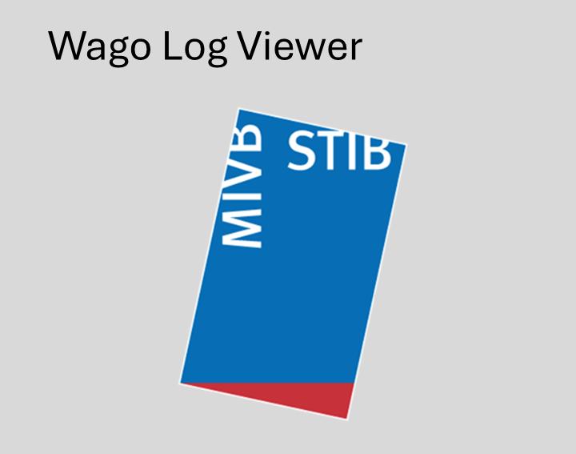

# Wago Log Viewer

Visualiseur de logs d'automate **Wago** développé par Eloïse Plas à la STIB-MIVB BUT Technical Tram pour l'utilisation d'un data-recorder. Il permet de charger un ou plusieurs fichiers de logs (jusqu'à 24 h d'acquisition à 50 Hz, soit plusieurs millions de lignes), de visualiser les signaux analogiques et digitaux, et de faire des mesures précises au curseur.



## Fonctionnalités

- **Visualisation TEMPS RÉEL** *(version 5)* : onglet « Temps réel ▶ » qui lit le fichier en cours d'écriture sur l'automate (via SFTP ; hôte et identifiants configurables, voir [Configuration de la connexion](#configuration-de-la-connexion)) et le rafraîchit toutes les 200 ms. Le graphe défile en continu et affiche une fenêtre glissante de 10 s. Voir [Mode temps réel](#mode-temps-réel).
- **Chargement multi-fichiers** : fusion automatique de plusieurs journées de logs, avec barre de progression (le chargement tourne dans un thread séparé, l'interface reste réactive).
- **Deux modes d'affichage** :
  - *Signaux* : un graphique par canal, empilés verticalement, axes X liés ;
  - *Superposition* : tous les canaux sur un seul graphique avec légende.
- **Curseurs synchronisés** : un clic gauche place le curseur C1 dans les deux onglets ; le bandeau du haut affiche les valeurs de tous les canaux sélectionnés à cet instant.
- **Double curseur (mesure)** : active un second curseur C2 et affiche les écarts Δt et Δ valeurs entre C1 et C2.
- **Fenêtre temporelle** : préréglages (10 s, 30 s, 1 min, …) ou saisie manuelle début/fin.
- **Navigation sur fronts 44P** : détecte tous les fronts montants du signal `DI44P` et permet de sauter de l'un à l'autre (boutons ◄ ►), vue centrée sur ±2,5 min.
- **Personnalisation** : couleur de chaque courbe (clic droit → Couleur), plages Y manuelles, plages Y partagées automatiquement entre canaux d'une même famille (ex. `Imot1`/`Imot2`).
- **Performance** : downsampling min-max adaptatif au zoom — plus on zoome, plus la résolution affichée augmente, sans jamais tracer des millions de points.

## Format des fichiers de logs

Fichiers texte CSV avec en-tête, séparateur `,` :

```
Date, AI1, AI2, DI1, DI2, DI3
18/03/2026 14:30:40:779, 0.06591998, 0.0, FALSE, FALSE, FALSE
18/03/2026 14:30:40:799, 0.07080294, 0.0
```

| Colonne | Contenu |
|---------|---------|
| `Date`  | Horodatage `jj/mm/aaaa HH:MM:SS:mmm` (millisecondes séparées par `:`) |
| `AI*`   | Entrées analogiques (flottants, en volts) |
| `DI*`   | Entrées digitales (`TRUE`/`FALSE` ou `1.0`/`0.0`) |

Les lignes incomplètes sont tolérées : l'automate n'écrit une valeur que lorsqu'elle change. Les valeurs manquantes sont complétées par propagation de la dernière valeur connue (*forward fill*).

## Configuration de la connexion

Les paramètres de l'automate (hôte, utilisateur, mot de passe) **ne sont pas
codés en dur** dans le code source. Ils sont résolus, par ordre de priorité :

1. **Variables d'environnement** : `WAGO_PLC_HOST`, `WAGO_PLC_USER`,
   `WAGO_PLC_PASSWORD`.
2. **Fichier `wago_plc.ini`** (non versionné), placé à côté de l'exécutable ou
   à la racine du projet. Copier le modèle fourni pour démarrer :

   ```bash
   cp wago_plc.ini.example wago_plc.ini
   ```

   ```ini
   [plc]
   host = xx.x.x.xx
   user = xxxxxxxxx
   password = xxxxxxxxxx
   ```
3. **Saisie directe dans l'interface** : si rien n'est configuré, les champs de
   l'onglet « Temps réel » sont vides et se remplissent à la main.

## Mode temps réel

L'onglet **« Temps réel ▶ »** affiche les signaux au fur et à mesure que
l'automate les enregistre, avec une fenêtre glissante (10 s par défaut) qui se
décale en continu. Trois sources sont disponibles :

| Source | Usage | Configuration |
|--------|-------|---------------|
| **Simulation (test)** | Visualiser le rendu **sans automate ni fichier** — idéal pour valider l'affichage. | Aucune : signaux de test générés à 50 Hz. |
| **Automate Wago (SFTP)** | Cas réel : lit le fichier directement sur l'automate (SSH, port 22 — même protocole que WinSCP). | Hôte / utilisateur / mot de passe pré-remplis depuis la configuration (voir [Configuration de la connexion](#configuration-de-la-connexion)) et modifiables dans l'interface. « Fichier du jour » coché par défaut → `/media/6289-794F/stib/logs_<date>.txt`, avec **bascule automatique à minuit** sur le fichier du jour suivant. |
| **Fichier local (direct)** | Suivre un fichier local qui grossit en continu. | Chemin du fichier. |

Mode d'emploi : choisir la source → régler éventuellement la cadence
(défaut 200 ms) et la largeur de fenêtre (défaut 10 s) → cocher les canaux à
afficher → **▶ Démarrer**. **■ Arrêter** met fin à la session.

### Comment ça marche

- La lecture est **incrémentale** : seuls les octets ajoutés depuis le dernier
  cycle sont téléchargés (en SFTP, `seek` à l'offset puis lecture du reste), ce
  qui reste léger même après des heures d'acquisition.
- Le polling tourne dans un thread séparé (`ui/live_worker.py`) : l'interface
  reste fluide.
- Les lignes reçues alimentent un **tampon glissant** (20 s) sur lequel la
  logique métier est appliquée (`AID3` → vitesse, propagation des dernières
  valeurs). Le graphe (`ui/live_plot_pane.py`) n'affiche que la fenêtre voulue.
- **Reprise automatique** : si le fichier cesse de grossir, l'affichage se fige
  sur les dernières secondes ; dès qu'il recommence à grossir, l'affichage
  reprend tout seul. Cela vaut aussi si le fichier est **réinitialisé**
  (nouvelle session, rotation) : la source détecte la troncature et repart du
  début du nouveau fichier — sans avoir à arrêter/redémarrer.


## Installation

Prérequis : **Python 3.10+** (testé sous Windows 11).

```powershell
# 1. Créer un environnement virtuel (recommandé)
py -m venv .venv
.venv\Scripts\activate

# 2. Installer les dépendances
pip install -r requirements.txt

# 3. Lancer l'application
python main.py
```

## Structure du projet

```
wago-log-viewer/
├── main.py                        ← point d'entrée de l'application
├── requirements.txt               ← dépendances Python
├── WagoLogViewer.spec             ← configuration PyInstaller (exécutable)
├── assets/                        ← icône et écran de démarrage
└── wago_log_viewer/
    ├── time_utils.py              ← conversions horodatage ↔ axe des graphiques
    ├── data/                      ← TRAITEMENT DES DONNÉES (sans GUI, testable)
    │   ├── log_parser.py          ← lecture .txt → DataFrame (+ parse_block incrémental)
    │   ├── log_processing.py      ← fusion, injection de zéros, conversion vitesse
    │   ├── live_source.py         ← sources temps réel (SFTP, fichier)
    │   └── signal_analysis.py     ← détection de fronts montants + cache
    └── ui/                        ← INTERFACE GRAPHIQUE (PySide6 + pyqtgraph)
        ├── main_window.py         ← fenêtre principale (orchestration)
        ├── plot_pane.py           ← zone de tracé, downsampling, curseurs
        ├── live_view.py           ← onglet « Temps réel » (orchestration live)
        ├── live_worker.py         ← polling de la source temps réel (thread)
        ├── live_plot_pane.py      ← graphe à fenêtre glissante (temps réel)
        ├── channel_selector.py    ← liste de canaux à cocher (réordonnable)
        ├── cursor_info_pane.py    ← bandeau des valeurs sous les curseurs
        ├── range_dialog.py        ← dialogue de réglage des plages Y
        ├── workers.py             ← chargement des fichiers en arrière-plan
        └── theme.py               ← thème sombre de l'application
```

### Pipeline de traitement des données

Au chargement d'un ou plusieurs fichiers (`ui/workers.py`), les étapes suivantes s'enchaînent (toutes dans `data/log_processing.py`) :

1. **Lecture** (`log_parser.read_wago_txt`) — parsing rapide via pandas, avec repli sur un parsing manuel tolérant si le fichier est mal formé.
2. **Fusion** (`unify_columns`) — union des colonnes de tous les fichiers, tri par date, suppression des doublons.
3. **Injection de zéros** (`inject_zeros_in_gaps_1hz`) — l'automate n'enregistre que lorsqu'il y a de l'activité ; des lignes à zéro sont insérées à 1 Hz dans les trous pour éviter les droites trompeuses entre deux sessions.
4. **Logique AI/DI** (`apply_ai_di_logic`) — conversion de la tension dynamo `AID3` en vitesse `AIVitesse` (calibration : `v = 0,316 × (U − 0,2197534)`), propagation des dernières valeurs connues, mise à zéro des lignes sans aucune mesure.

### Points techniques à connaître

- **Downsampling** (`ui/plot_pane.py`) : avant tracé, chaque signal est réduit à ~10 000 points. Analogique → *bucketing min-max* (préserve les pics) ; digital → seules les transitions sont conservées (plus le point précédant chaque transition, pour dessiner des échelons et non des diagonales). Pendant un zoom ou un défilement, les courbes sont ré-échantillonnées au plus toutes les 50 ms (*throttle*) sur la fenêtre visible **élargie d'un écran de chaque côté** : les signaux restent ainsi visibles pendant le défilement horizontal.
- **Fuseaux horaires** (`time_utils.py`) : les horodatages des logs sont en heure locale « naïve », mais pyqtgraph affiche les secondes Unix en heure locale. Toutes les conversions passent par ce module unique pour rester cohérentes.
- **Debounce** : les changements de sélection (150 ms) et de zoom (50 ms) sont différés pour éviter un re-tracé par clic / par événement de molette.
- **Cache des fronts 44P** (`data/signal_analysis.py`) : la détection sur 4 millions de lignes prend quelques secondes ; le résultat est mis en cache et invalidé automatiquement (hash du DataFrame) si les données changent.

## Générer l'exécutable Windows

```powershell
py -m pip install PyInstaller
py -m PyInstaller WagoLogViewer.spec
```

L'exécutable autonome est produit dans `dist/WagoLogViewer.exe` (icône STIB + écran de démarrage inclus). Aucune installation de Python n'est nécessaire sur la machine cible.

## Contact

Code développé dans le cadre de la mission Young Starter de Eloïse Plas à la STIB-MIVB BUT Technical Tram pour l'utilisation d'un data-recorder
